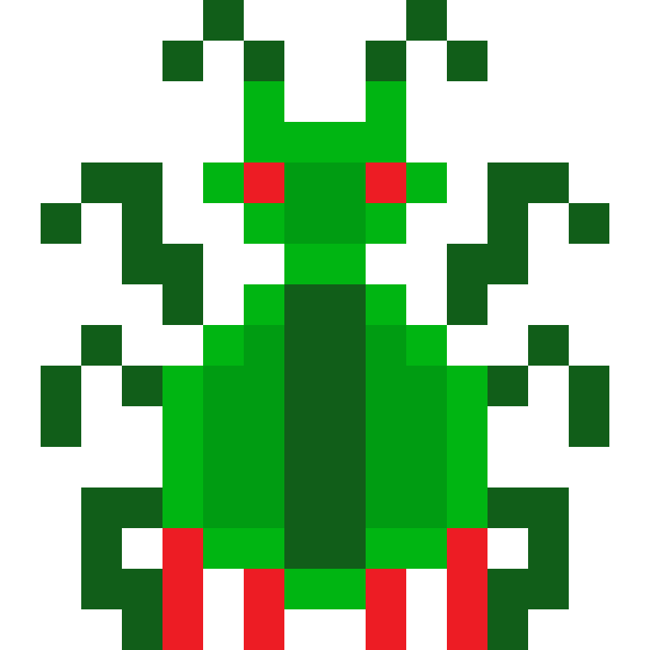

<p align="center">
  
</p>

# Syntax Error: Code Tower Defense

> **Knight Hacks IX Hackathon Project**  
> *Gavin Heaver: Player Systems, UI, In-Game Scripting Sandbox & Economy* <br>
> *Tadhg Hallahan: Path Finding, Enemy AI, Flow Fields, Pheromones & Wave Generation*

[](https://www.python.org/)
[](https://pyga.me/)
[](https://pygame-gui.readthedocs.io/)
[](https://knighthacks.org/)

---

## Getting Started

### 1. Clone the Repository
```bash
git clone https://github.com/GavinHeaver/KnightHacks_IX_Syntax_Error.git
cd KnightHacks_IX_Syntax_Error
```

### 2. Install Dependencies
```bash
# Make sure standard pygame is removed to avoid namespace conflicts
pip uninstall -y pygame
pip install -r requirements.txt
```

### 3. Run the Game
```bash
python main.py
```
---

## Overview

**Syntax Error: Code Tower Defense** is an algorithmic, cyber tower defense game where defense meets computer science. Players protect a central CPU on an interactive circuit-board grid from escalating waves of malicious bugs, zero-day exploits, and code injections. 

Unlike traditional tower defense games with static upgrades, **Syntax Error** revolves around two core pillars:
1. **Live In-Game Python Programming**: Every defense turret runs real, sandboxed Python code that players edit, compile, and debug directly in-game.
2. **Creative Pathfinding & Adaptive Swarm AI**: Enemies don't follow static paths. Swarms use layered Dijkstra flow fields, enemy-specific cost personalities, dynamic traffic layers, and an ant-colony-inspired pheromone system that remembers where bugs die and actively routes future waves around player kill-zones.

---

## Advanced Pathfinding & Swarm Intelligence

*Built for the creative pathfinding challenge category, the swarm AI uses graph theory and biological swarm learning:*

### 1. Layered Dijkstra Flow Fields
Rather than running expensive individual $A^*$ searches for hundreds of individual bugs, the game calculates a **unified vector flow field** radiating outward from the CPU goal tiles using a min-heap priority queue (`heapq`).
* **Complexity**: Solved in $O(V \log V)$ once per enemy type, meaning swarms can scale to hundreds of enemies with zero frame drops.
* **Dynamic Rebuilding**: Flow fields recalculate only when the grid structure changes (`board.dirty`) or on the periodic AI pheromone tick.

### 2. Multi-Layer Cost Formulation & Personality Weights
Every enemy type evaluates the board through a personalized cost function:

$$c_e(t) = 1 + w_{e,\text{wall}} L_{\text{wall}}(t) + w_{e,\text{fire}} L_{\text{fire}}(t) + w_{e,\text{fear}} L_{\text{fear}}(t) + w_{e,\text{crowd}} L_{\text{crowd}}(t)$$

* **$L_{\text{wall}}$ (Obstacle Chew Time)**: Tools are passable at a cost proportional to their durability ($\text{HP} / \text{DPS}_{\text{bug}}$). If completely walled off, bugs chew through the weakest barricade.
* **$L_{\text{fire}}$ (Firing Danger Map)**: Precomputed threat map measuring turret coverage and DPS.
* **$L_{\text{fear}}$ (Death Pheromones)**: Biological fear map tracking where bugs were eliminated.
* **$L_{\text{crowd}}$ (Traffic & Congestion Layer)**: Smoothed density of swarm units per tile. Heavily congested lanes become more expensive, causing swarms to naturally split up and flank from multiple avenues.

| Enemy Type | $w_\text{wall}$ | $w_\text{fire}$ | $w_\text{fear}$ | $w_\text{crowd}$ | Behavioral Goal |
|---|:---:|:---:|:---:|:---:|---|
| **Bug** (Basic Swarm) | 1.0 | 0.2 | 0.5 | 0.5 | Direct path to CPU |
| **Memory Leak** (Tank) | 0.3 | 0.0 | 0.0 | 0.0 | Plows through walls, splits on death |
| **Zero-Day** (Infiltrator) | 1.0 | 1.0 | 1.0 | 1.0 | Leaps obstacles, avoids fire |
| **Injection** (Saboteur) | $\infty$ on Firewall | 2.0 | 2.0 | 1.5 | Hunts programmable towers to corrupt code |

### 3. Biological Pheromone Swarm Learning
When bugs are destroyed, they emit a fear pheromone ($+1.0$) at that tile. On every AI tick, the fear map undergoes spatial diffusion (blurring) and evaporation:

$$F_{t+1}(x) = \lambda \big(0.6\,F_t(x) + 0.4\,\overline{F_t}(\text{neighbors})\big), \quad \lambda \approx 0.97$$

* **Inter-Wave Memory**: 50% of the pheromone map carries over between waves.
* **Emergent Swarm Intelligence**: Kill-zones that wiped out bugs in Wave 1 become "feared" in Wave 2, causing subsequent waves to dynamically reroute and flank player blind spots.

### 4. Zero-Day State-Augmented Leap Planning
Zero-Day bugs feature a **layered state graph** search `(tile, skipAvailable)`. The AI computes a dual field ($D_0$ and $D_1$), planning its route knowing it has a one-time leap over walls or firewalls, seamlessly switching to the standard flow field once the jump is executed.

### 5. Adaptive Wave Director
The wave director evaluates the flow-field cost along all map edges and applies a temperature-scaled **softmax probability distribution** ($P(s) \propto e^{-D(s)/T}$). The director probes defense weaknesses while adapting $T$ to the player's performance.

---

## In-Game Python Programming System

Players do not just watch towers fire—they program their logic in real Python using the in-game editor:

```python
def tick():
    # Scan for incoming threats (sorted nearest first)
    targets = enemiesInRange()
    if len(targets) > 0:
        aim(targets[0])
        fire()
```

### Sandboxing & Security Engine
* **AST Static Analysis (`ast.NodeVisitor`)**: Scans player code before execution. Rejects forbidden constructs such as `import`, `from ... import`, and all dunder/private attributes (`__dict__`, `__class__`).
* **Language Concept Gating**: AST validators enforce shop unlocks. Language features such as `ast.For`, `ast.While`, and `memory` raise compile-time errors until unlocked in the shop.
* **Cycle Budgeting (`sys.settrace`)**: To prevent game-freezing infinite loops (`while True: pass`), execution attaches a trace hook counting `"line"` events. If code exceeds the tower's tier cycle budget, the engine interrupts the tick, raises `CyclesExceededError`, flashes `"OUT OF CYCLES"`, and jams the tower safely.
* **Read-Only Security Proxies (`EnemyView`)**: Player scripts only receive immutable dataclass views (`hp`, `distance`, `speed`, `type`). Enemy types remain `"unknown"` unless unmasked by a Debugger tower.
* **Persistent Tower Memory**: Towers maintain a sandboxed `memory` dictionary that persists state across ticks.

---

## Software Engineering & Architecture

The codebase adheres strictly to clean **Object-Oriented Programming (OOP)** and modular design patterns:

* **Model-View-Controller (MVC) Separation**:
  * **Model**: `Board`, `GameState`, `TowerScript`, `Enemy`, `DefenseTool`, `Projectile`.
  * **View**: `drawBoard()`, `HUD`, `StartMenu`, `DebugOverlay`.
  * **Controller**: Main event loop, `uiManager`, and `ShopPanel`.
* **Polymorphic Class Hierarchies**:
  * `DefenseTool` $\to$ `Turret` (programmable attacker), `Firewall` (barrier wall), `Debugger` (programmable scanner/revealer).
  * `Enemy` $\to$ `Bug`, `MemoryLeak`, `ZeroDay`, `Injection`.
* **Decoupled Event Bus (`events.py`)**:
  * Uses a pub/sub event bus (`enemyKilled`, `toolDestroyed`, `cpuHit`) to decouple audio, economy, AI updates, and UI notifications.
* **Deterministic Demo Mode**:
  * Seeded pseudorandom generation (`DEMO_SEED`) ensures reproducible paths and pheromone demonstrations for judging.

---

## 🛠️ Tech Stack & Requirements

* **Language**: Python 3.11 / 3.12
* **Game Engine**: `pygame-ce` (Community Edition)
* **UI Toolkit**: `pygame_gui`
* **Standard Library**: `ast`, `sys`, `heapq`, `math`, `random`, `json`, `dataclasses`, `collections`

---

## Key Controls & Shortcuts

| Key / Action | Function |
|---|---|
| **Left Click (Grid)** | Place selected Defense Tool (costs Bytes) |
| **Left Click (Tower)** | Inspect Tower & Open Python Code Editor |
| **Right Click (Tower)** | Sell Tower (Recovers 50% Bytes) |
| **`[SPACE]`** | Start Next Bug Wave |
| **`[F1]`** | Toggle Flow-Field Vector Arrows (Debug Overlay) |
| **`[B]`** | Spawn Debug Bug (Test Pathfinding) |
| **`[ESC]`** | Pause / Back to Main Menu |

---

Developed with pride at **Knight Hacks IX**
